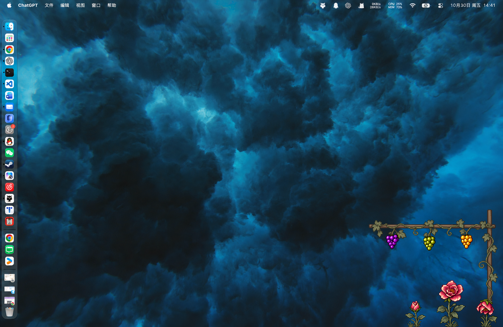
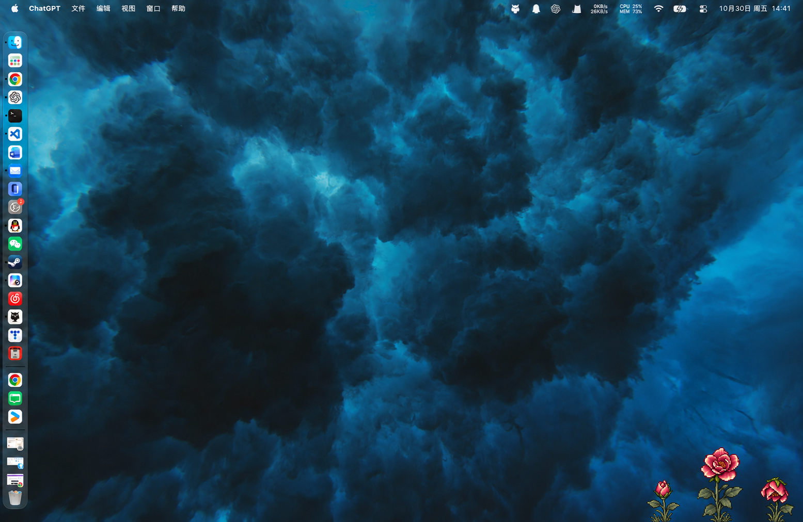

# Appearance · 葡萄藤桌面外观

葡萄藤、葡萄、杰瑞动作与 DDL 花朵的外观仓库。保存设计稿、动画预览、素材、macOS 展示外壳与已确认版本；文件分类核心独立维护，不包含在本仓库。

当前 App 外观：**轻盈像素植物挂件 v1（2026-10-31 接入原生 App）**。此前快照标签：`grounded-garden-v1-2026-10-30`。

## 最新设计

2026-10-31 位置修正：当前 App 将葡萄架立柱底部与屏幕底边对齐，取消早期设计的 72 点上移留白；花朵根部位置保持不变，花与木架绑定同一显示器。下方设计截图保留原版构图供对照。

常驻花层约 289×148，葡萄架图层约 400×292（参考桌面 1555×1012），保持右下角定位。最新调整将葡萄架整体上移 72 像素，花朵位置和所有尺寸保持不变，增加花朵上方留白；完整组合的外接范围约 400×364。三株莓玫瑰错落生长，连续草坪改为零散草叶；木架和叶片降饱和度，花朵与三色果串保留色彩重点。葡萄架隐藏时共用同一花层，花朵保持原位。





轻盈构图的核对页仍保存静态设计。原生 App 现已使用本版轻盈像素木架与分株花素材：葡萄按真实分类计数逐粒生长，DDL 对应独立花朵。花层常驻右下角，葡萄层在投喂与预览时显示；封存版素材保持原样。

- [这版设计、尺寸及三类背景核对](design/compact-garden/v1/README.md)
- [完整生成提示词](design/compact-garden/v1/GENERATION.md)
- [此前分离构图](design/grounded-garden/v1/README.md)
- [版本记录](VERSIONS.md)
- [已确认花朵 v2.0 封存版](design/releases/README.md)
- [此前花朵与葡萄架的动态组合预览](design/final-garden/v1/README.md)

## 目录

```text
design/
  compact-garden/v1/        最新轻盈构图、透明素材、背景核对与尺寸说明
  grounded-garden/v1/       此前地面花丛构图，两种可见状态
  final-garden/v1/          此前组合的交互预览与动画成片
  stardew-inspired/         像素风设计、花型及动态试验
  releases/                已确认花型的不可变封存快照
frontend/macos/            原生动画外壳、素材与现有检查
```

历史设计稿与核验图一并保留，便于回看演进。临时文件、构建产物和分类后端不入库。

## 直接打开 App

日常使用可直接双击 `frontend/macos/build/FilePetShell.app`。App 会在后台启动本机分类核心、等待就绪后自动连接，无需单独运行脚本或保持终端。退出 App 时会同时结束自己启动的核心。`启动葡萄藤.command` 无参数运行时也只负责打开这个 App。

默认仅处理主动投喂或选择的文件，不会扫描文件夹。自动模式允许读取当前用户主目录下的文件，系统受保护的目录仍由 macOS 的读取权限控制。此为本机非 App Store 构建，使用已安装的 Python 分类环境；尚未把解释器和依赖打包为可拷贝到任意 Mac 的独立运行包。

从源码构建需要 macOS 13+、完整 Xcode，以及相邻 `filepet-engine/` 中已安装依赖的 `.venv`：

```bash
cd frontend/macos
./build-app.sh
open build/FilePetShell.app
```

构建时会将本机核心目录记录到生成的 App 配置；源码不写死个人路径。核心在其他位置时，可在构建前设置 `FILEPET_ENGINE_ROOT`。程序启动时会优先使用该环境变量，再检查 App 中记录的位置与相邻核心目录。

开发时仍可使用单独服务和自定义授权目录：

```bash
./run-dev.sh --examples
./run-dev.sh --root "$HOME/Downloads"
# 或连接已启动的核心
open build/FilePetShell.app --args --engine-url http://127.0.0.1:8765
```

这是显式外部核心模式，终端需保持运行。使用前退出已运行的 App，确保本次启动参数生效；随后从 Finder 直接打开 App 会恢复自动模式。

更多边界和检查命令见 [macOS 外壳说明](frontend/macos/README.md)。投喂包含明确截止日期的文件，会为每条 DDL 生成一朵花；最多同时三朵，多余按投喂顺序排队。悬停查看内容、日期/时间和项目，点击收获即完成 DDL，下一项自动补位。队列与完成记录保存在本机，重复投喂同一 DDL 不会重新开花。缺失年份会标注推定，未注明时间不会补造。

没有 DDL 的成功分类文件按类别增长葡萄，一类一株、每个新增文件一颗；重复路径不会重复增长。葡萄数量与花朵完成均为本机展示记录，原文件保持原位。

## 验证记录

轻盈构图的静态设计记录见 `design/compact-garden/v1/verification.json`。2026-10-31 将同一像素木架、三色果实与花层尺寸接入原生渲染，替换旧弯藤与光滑葡萄。基底剥离素材中的固定果串，空分类不会显示样例葡萄；真实文件数控制每株果粒数。原生渲染检查可导出深浅背景、空木架、两类各一粒和三类满串组合图，生成物保存在 `frontend/macos/.tmp/compact-qa/`。封存版保持原样。

花果接线阶段：Python 72 项通过，Swift 62 项通过（包含两项真实 HTTP 核心联调及花朵透明命中渲染检查），0 失败。

自动启动阶段：Swift 73 项中 71 项通过，2 项外部核心联调按默认跳过；本次包含真实后台核心启动/停止/重启与旧版记录迁移检查。新版 App 已直接启动并显示已连接，旧葡萄计数保留；release 构建与本地签名校验通过。

首次导入快照的文件校验值见 [SNAPSHOT.json](SNAPSHOT.json)，不包含本次新外观。生成设计图所用提示词及内置 image_gen 方式记录在各设计目录。

本轮原生外观接入验证（2026-10-31）：Swift 79 项中 77 项通过、2 项外部服务联调按默认跳过；新增像素素材、真实果粒数量、紧凑布局和杰瑞接触坐标检查全部通过。深浅底色原生画面已导出核对，App 0.3.0 构建与签名通过，实际打开后已确认新版木架与核心连接正常。
