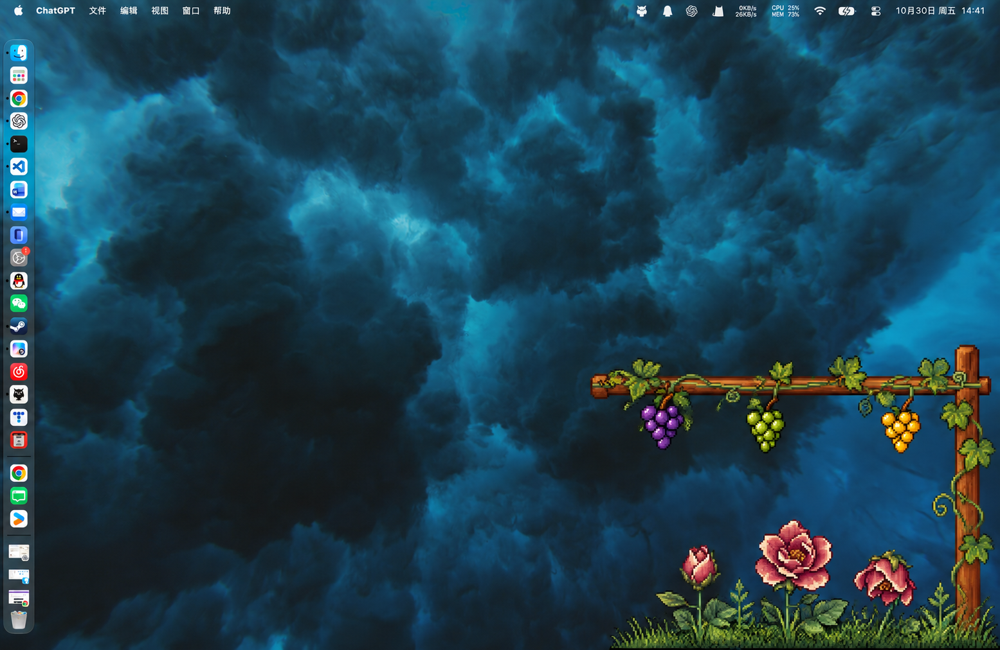
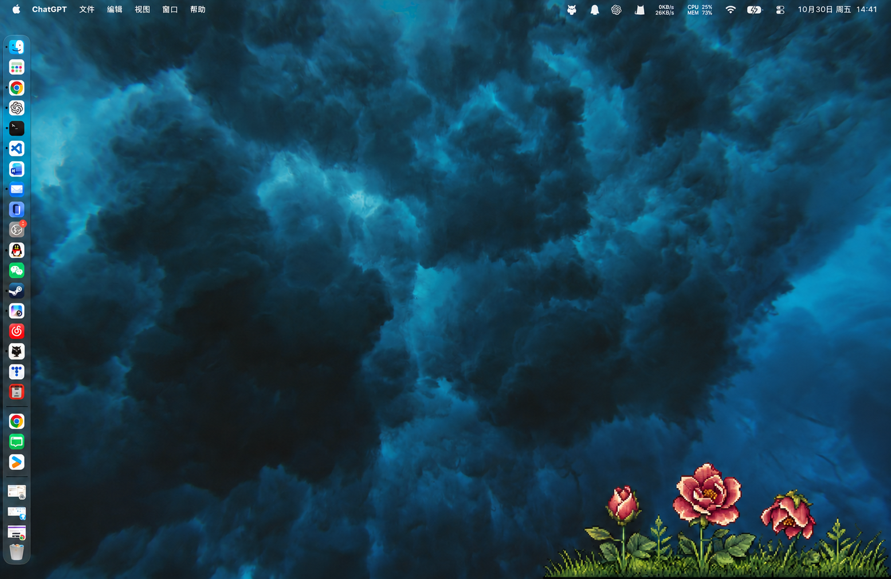

# Appearance · 葡萄藤桌面外观

葡萄藤、葡萄、杰瑞动作与常驻花朵的外观仓库。保存设计稿、动画预览、素材、macOS 展示外壳与已确认版本；文件分类核心独立维护，不包含在本仓库。

当前记录：**2026-10-30 · 地面花丛与葡萄架分离 v1**。版本标签：`grounded-garden-v1-2026-10-30`。

## 最新设计

葡萄架位于桌面右下区域的上方，仅承载葡萄、葡萄叶与藤。莓玫瑰独立长在屏幕底边的小草丛中，短茎基部藏入草里；葡萄架隐藏时，花丛单独常驻。





这两张是静态构图设计稿，尚未接入 macOS 动画。已有交互预览与应用源码仍保留各自原有的视觉状态，不能视为最新构图的实现。

- [这版设计的说明与提示词](design/grounded-garden/v1/README.md)
- [版本记录](VERSIONS.md)
- [已确认花朵 v2.0 封存版](design/releases/README.md)
- [此前花朵与葡萄架的动态组合预览](design/final-garden/v1/README.md)

## 目录

```text
design/
  grounded-garden/v1/       最新地面花丛构图，两种可见状态
  final-garden/v1/          此前组合的交互预览与动画成片
  stardew-inspired/         像素风设计、花型及动态试验
  releases/                已确认花型的不可变封存快照
frontend/macos/            原生动画外壳、素材与现有检查
```

历史设计稿与核验图一并保留，便于回看演进。临时文件、构建产物和分类后端不入库。

## 运行已有动画外壳

需要 macOS 13+ 和完整 Xcode。在本仓库中运行：

```bash
cd frontend/macos
./build-app.sh
open build/FilePetShell.app
```

动画演示可离线使用。分类功能需要另行启动外部 FilePet Engine，可在启动外壳时指定本机接口：

```bash
open build/FilePetShell.app --args --engine-url http://127.0.0.1:8765
```

`run-dev.sh` 和 `启动葡萄藤.command` 保留了原联合工作区的启动方式，依赖同一根目录内的 `backend/` 与 `.venv/`，不适用于本仓库的独立目录。请使用上方的构建与启动方式。

更多边界和检查命令见 [macOS 外壳说明](frontend/macos/README.md)。当前花朵是视觉样例，尚未接入真实 DDL；分类反馈和收葡萄动画均不代表文件已被移动。

## 本次记录的验证

现有 Swift 检查：50 项通过、1 项需要真实分类核心的检查按默认跳过，0 失败。导入的动画源码与工作区原件一致。封存版按其 SHA256 清单核对，最新两张设计图已核对文件完整性。

本次源码、素材和说明的文件校验值见 [SNAPSHOT.json](SNAPSHOT.json)。生成设计图所用提示词及内置 image_gen 方式记录在各设计目录。
